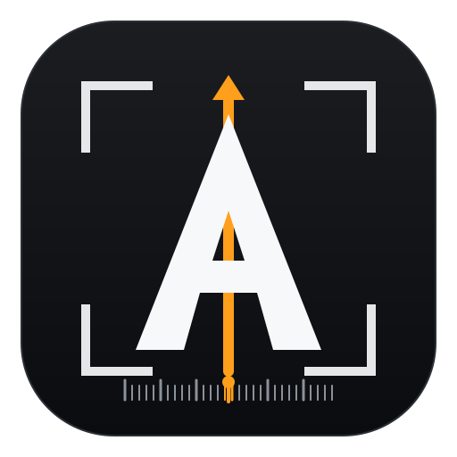

<div align="center">



# AFC

**Arknights Frame Counter · 明日方舟全局逻辑帧计数器**

一个基于画面识别工作的明日方舟全局帧数计数与打轴工具。

不读取游戏内存，不修改游戏文件，只截取游戏窗口里的费用条和右上角 UI，实时显示当前逻辑帧。

[](https://www.microsoft.com/windows)
[](https://www.python.org/)
[](https://github.com/meijian07/Arknightsframecomputer/releases)
[](https://github.com/meijian07/Arknightsframecomputer/releases)
[](LICENSE)

</div>

## 目录

- [下载及启动](#下载及启动)
- [主要功能](#主要功能)
- [使用说明](#使用说明)
- [使用前注意](#使用前注意)
- [精度与已知限制](#精度与已知限制)
- [开发与自检](#开发与自检)
- [项目结构](#项目结构)
- [项目逻辑](#项目逻辑)
- [声明](#声明)
- [鸣谢](#鸣谢)

## 下载及启动

1. 打开 [GitHub Releases](https://github.com/meijian07/Arknightsframecomputer/releases/latest) 下载最新的 Windows 压缩包。
2. 解压后双击 `AFC.exe`，不需要安装。
3. 先进入游戏关卡，让画面里出现费用条、暂停键和倍速键。
4. 在面板上选择 `PC端` 或 `窗口` 模式。
5. 完成校准后点击「开始」。

实时计数使用 Windows 抓屏，不需要 ffmpeg；只有离线录像分析才需要 ffmpeg。

## 主要功能

**全局逻辑帧计数。** 程序通过费用条的像素增长计算当前逻辑帧，费用条满时改用挂钟继续计数，并用暂停键、倍速键和 HUD 判断游戏状态。支持 100% 正常回费、75% 一级减费、50% 二级减费和 25% 三级减费，也支持自定义百分比。

**多种输入源。** 既能直接读取 PC 端游戏窗口，也能读取播放器、模拟器或其他可见窗口中的游戏画面，方便分析录像和不同窗口环境。

**打轴器。** 可以导入或创建 Markdown 轴文件，在计数器到达对应帧号时显示操作提示，并根据当前帧自动滚动提词器。

### 回费效率对照

| 显示 | 内部含义 |
| --- | --- |
| `100% 正常回费` | 30 帧 / 费 |
| `75% 一级减费` | 40 帧 / 费 |
| `50% 二级减费` | 60 帧 / 费 |
| `25% 三级减费` | 120 帧 / 费 |

## 使用说明

### 主面板

| 按键 | 说明 |
| --- | --- |
| 开始 / 暂停 / 继续 | 控制采样和计数 |
| 清零 | 停止计数并把帧号、时间归零 |
| 校准：PC端 / 窗口 | 切换输入来源 |
| 手动校准 | 调整费用条、暂停键、倍速键的位置与大小 |
| ▴ / ▾ | 展开或收起打轴器 |

程序不注册键盘快捷键，避免和游戏内按键冲突。

### 两种输入模式

- **PC 端**：直接读取游戏窗口。程序会根据客户区尺寸和游戏 UI 缩放推算 ROI。
- **窗口**：读取任意可见窗口，例如模拟器游戏画面和播放器里的录屏。画面可能被缩放和截取，因此通常需要手动校准。

切换模式会自动清零。窗口模式会尽量把目标窗口保持置顶，避免被其他窗口遮挡。

### 手动校准

1. 点击「手动校准」打开取景器。
2. 先选择「费用条」，让框左右两端贴住条槽，高度贴合费用条。
3. 再选择「暂停键」和「倍速键」，让虚影覆盖右上角按钮。
4. 在右侧放大图中检查边缘，必要时用下方按钮按 1 像素微调。
5. 点击「用这些框」应用校准。

手动框是红色实线，自动推算框是白色虚线。费用条对准后，负号扫描框会根据费用条位置自动推算，不需要单独框选。

### 回费效率

在面板的「回费效率」下拉框中选择百分比。切换到非预设百分比时，可以输入自定义数值并点击「应用」。自定义输入支持 `50` 或 `50%` 两种写法。

### 打轴器

轴文件是一份 Markdown 文本，例如：

```text
## 120 帧
部署 银灰 在 A2

- 350 开银灰技能
- 1:05 开能天使技能
```

帧号写在每行最前面，也可以使用 `1:23` 这样的时间写法。展开面板后点击「导入轴…」加载文件，计数器走到对应帧时会自动滚动提词器。

## 使用前注意

- 游戏窗口必须保持可见，费用条和右上角按钮不能被其他窗口遮住。
- 修改游戏内 UI 缩放、窗口大小或分辨率后，建议重新校准。
- 窗口模式读取的是屏幕上的可见画面，播放器暂停、最小化或被遮挡时无法正确计数。
- 游戏画面设置为 60 / 120 帧不会改变逻辑帧率，明日方舟的逻辑时钟固定为 30 FPS。
- 鼠标划过费用条影响计数，操作时尽量不要划过费用条。
- 萨卡兹术士结晶会锁定费用条，目前尚未单独处理这种状态。


## 精度与已知限制

- 正常回费下，一个费用周期按 30 逻辑帧计算。
- 长期运行时使用费用条满锚点修正累计误差，目标是把误差控制在单个周期附近。
- 25% / 50% 等减费环境开头几帧难以计数，会从3或4帧开始。
- 回费效率需要手动选择。
- 暂停键、倍速键和费用条被裁切、强压缩或 UI 缩放异常时，识别可能不稳定。
- 局内负费依靠费用数字左侧的减号框判断。
- 打轴器的帧号按 1 倍速逻辑帧计算，倍速只改变走到该帧的速度。
- 目前主要面向 Windows 10 / 11 的 PC 端。
- 模拟器可能因帧率不稳定、掉帧导致计数不准确，建议使用 PC 端。

## 开发与自检

### 环境

需要 64 位 Windows 和带 tkinter 的 Python 3.9 以上。

```powershell
python -m venv .venv
.venv\Scripts\python.exe -m pip install -r requirements.txt
.venv\Scripts\python.exe run_monitor.py
```

### 项目结构

```text
AFC/
├─ run_monitor.py                 # 图形界面入口
├─ run_reader.py                  # 离线读录像入口（CLI）
├─ build_app.ps1                  # 本地打包脚本
├─ akframe.spec                   # PyInstaller 打包配置
├─ requirements.txt               # Python 运行依赖
├─ assets/logo/afc/               # AFC 标志、图标与使用说明
├─ LICENSE
├─ README.md
│
├─ src/
│  └─ akframe/
│     ├─ ui.py                    # 主面板、打轴器、二级窗口、校准取景器
│     ├─ live.py                  # PC 端实时采样线程
│     ├─ window.py                # 读取任意窗口（播放器 / 录屏）
│     ├─ capture.py               # 输入源抽象与抓屏接口
│     ├─ win32.py                 # Windows 抓屏、置顶、窗口 API
│     ├─ geometry.py              # ROI 几何、分辨率表、布局与校准偏移
│     ├─ features.py              # 费用条、暂停键、倍速键、减号特征
│     ├─ state.py                 # 逻辑帧状态机与锚点修正
│     ├─ fp24.py                  # 定点数与费用相位模型
│     ├─ cost_rate.py             # 回费效率识别
│     ├─ timeline.py              # 轴文件解析
│     ├─ scale.py                 # 刻度表布局
│     ├─ scale_render.py          # 刻度表绘制
│     ├─ boxpick.py               # 手动框选与放大镜
│     ├─ calib.py                 # 校准与自动对齐
│     ├─ align.py                 # 费用条对齐工具
│     ├─ video.py                 # 录像抽帧与缓存
│     ├─ demo.py / synthesis.py   # 演示与合成测试数据
│     ├─ settings.py              # 回费效率、负费与设置文件
│     └─ resolutions_measured.json # 实测分辨率与 ROI 校准表
│
├─ templates/                     # 1X / 2X / 子弹时间模板
├─ maps/                          # 示例轴文件
├─ tools/                         # 自检、校准、预览与诊断脚本
│  ├─ check_*.py
│  ├─ calibrate.py
│  └─ fixtures/
├─ docs/                          # 开发记录与实测图片
│  ├─ 费用条读取逻辑.md
│  └─ images/
└─ .github/
   └─ workflows/
      └─ release.yml              # v* 标签自动打包并发布 Release
```

### 项目逻辑

```text
每一拍采样
└─ 计数器判断
   ├─ 手动暂停计数？
   │  └─ 是 → 本拍不增加帧数
   │
   ├─ 当前在关卡内吗？
   │  ├─ 否 → 不计数
   │  └─ 是
   │     ├─ 游戏暂停？
   │     │  └─ 是 → 本拍不增加帧数
   │     │
   │     ├─ 费用条未满、正常推进
   │     │  ├─ 看费用条像素增长
   │     │  ├─ 像素宽度 → 费用相位 → 逻辑帧数
   │     │  ├─ 1X / 2X 不影响这条通道（像素天然反映逻辑时间）
   │     │  ├─ 有负费减号 → 每逻辑帧只累计一半
   │     │  └─ 跨过下一次回费边界 → 周期锚点校正
   │     │
   │     ├─ 费用条满费（MAX / MAX_FADE）
   │     │  ├─ 挂钟直接计数
   │     │  ├─ 1X / 2X：30 × 倍速 = 每秒逻辑帧
   │     │  ├─ 子弹时间：固定每秒 6 帧
   │     │  └─ 出现 MAX 上升沿 → 满费锚点对齐全周期
   │     │
   │     └─ 费用条为空或读不到
   │        ├─ 刚跨过回费边界 → 新周期第 1 帧 +1
   │        └─ 其他情况 → 冻结
   │
   └─ 汇总本拍增量
      ├─ 绝对帧号 += 本拍逻辑帧
      ├─ 更新时间、刻度表和打轴器
      └─ 等待下一拍采样
```

核心规则只有一条：**费用条未满时看费用条，费用条满时直接按挂钟计数**。暂停键和 HUD 负责判断当前是不是在关卡内、游戏有没有暂停，避免在主菜单或其他界面错误计数。

### 自检

```powershell
$env:PYTHONIOENCODING='utf-8'
.venv\Scripts\python.exe tools\check_boxpick.py
.venv\Scripts\python.exe tools\check_ui_keys.py
.venv\Scripts\python.exe tools\check_ui_state.py
.venv\Scripts\python.exe tools\check_ui_window.py
```

### 打包

```powershell
powershell -ExecutionPolicy Bypass -File build_app.ps1
```

产物位于 `dist\AFC\`。正式发布包通过 GitHub Releases 分发，不提交进源码仓库。


## 声明

- 本项目使用 [MIT License](LICENSE) 开源。
- 本工具不修改游戏文件、不读取游戏内存。

## 鸣谢

- [ArknightsCostBarRuler](https://github.com/ZeroAd-06/ArknightsCostBarRuler)：校准思路的重要参考。
- [MaaAssistantArknights](https://github.com/MaaAssistantArknights/MaaAssistantArknights)：图像识别思路参考。
- [arknights-frame-assistant](https://github.com/CloudTracey/arknights-frame-assistant)：不可或缺的测试工具。
- DSv4f，她构建了本项目的主要代码，及所有参与测试和提供反馈的人。
